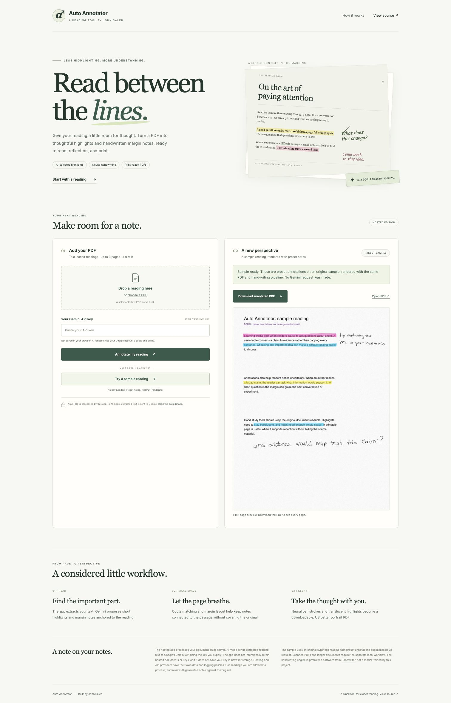

# Auto Annotator

**Turn a PDF reading into a print-ready, annotated copy.**

Auto Annotator combines AI-selected highlights with short handwritten margin notes. It extracts text and page coordinates, asks Gemini for structured annotations, checks quote anchors against the source, and uses neural pen strokes to render the notes into the PDF. Built by **John Saleh** as an independent software project.



## Try it

Open **[Auto Annotator](https://auto-annotator-lyart.vercel.app)** and choose the sample demo to see the real PDF rendering pipeline without a Gemini key. The demo uses fixed, clearly labeled annotations on a synthetic reading; it does not demonstrate AI analysis of your document.

To annotate your own reading, select a text-based PDF and supply your own Gemini API key. The hosted path accepts up to **3 pages and 4 MiB**, and the completed PDF must also fit within the hosted output limit. The interface shows processing status, a first-page image preview, and a PDF download when rendering finishes. If the image preview cannot load, the completed PDF remains downloadable.

## What it does

- Extracts readable prose and its coordinates with PyMuPDF.
- Uses Gemini structured responses for highlight quotes and margin-note anchors.
- Matches annotations back to the source text, with fallbacks for spacing and OCR differences.
- Places black neural handwriting in available margins and checks for collisions with printed content.
- Draws translucent, marker-style highlights and exports US Letter portrait pages.
- Applies an optional scan-style finish for printing. This flattens the finished pages into images, so searchable/selectable text may not be retained.
- Supports separate local queue endpoints with progress polling, annotation caching, and optional OCR.

The handwriting engine and pretrained weights are reused from Handwriter. Auto Annotator adds document extraction, AI annotation, anchor matching, margin layout, rendering, and the application workflow; it does not train a handwriting model.

## Hosted and local workflows

| | Hosted app | Local Flask app |
|---|---|---|
| Processing | One request returns the completed PDF | Background job with progress and download endpoints |
| API key | Visitor supplies a key for their request | Request key or local `GEMINI_API_KEY` for the queued endpoint |
| Input | Text-based PDFs, at most 3 pages and 4 MiB | Legacy queued endpoint permits uploads up to 500 MB; processing time and memory still limit practical size |
| OCR | Scanned/image-only PDFs are outside the hosted path | Optional Tesseract and English language data required |
| Saved annotations | Request-isolated temporary files | Local `.annotation_cache/` for resume/regenerate behavior |

The local page offers a **Use full local processing** checkbox for the queued workflow (`/api/annotate`, `/api/status/<job_id>`, and `/api/download/<job_id>`). Without that checkbox, the browser page uses the bounded synchronous route. The full local option supports compatible-cache reuse or fresh annotation requests. The 500 MB local upload ceiling is a request limit, not a performance guarantee. Large or complex PDFs can exceed available memory or take a long time. The hosted page limits keep the workflow within serverless request, response, and execution limits.

## Run locally

Use Python 3.9 or newer; Python 3.12 is recommended. The pinned dependencies include a Node.js binary for the handwriting bridge. An existing Node.js 18+ installation is also supported.

```bash
bash scripts/setup.sh
bash scripts/run.sh
```

Open **http://127.0.0.1:5001**. The sample demo needs no API key.

For local AI processing, copy `.env.example` to `.env`, set your key, and restart:

```bash
cp .env.example .env
```

Keep `.env` private. Gemini model availability, quotas, billing, and terms depend on the account that owns the key. If needed, set `GEMINI_MODEL` to a model available to that account.

On macOS, `launchers/AutoAnnotator.applescript` is an optional Finder launcher. Open it in Script Editor and export it as an Application. On first launch, choose the project folder containing `app.py`; it uses the same setup/run scripts. The source is portable and contains no personal absolute paths.

For OCR, install Tesseract and its English language data for your operating system. The local app detects available language data; OCR cannot recover every faint scan, layout, or mathematical expression.

## How the pipeline fits together

```text
PDF → prose and coordinates → structured Gemini annotations
    → quote-anchor verification → blank-margin layout
    → neural handwriting + marker highlights → downloadable PDF
```

`app.py` contains extraction, annotation, layout, and rendering. `templates/index.html` provides the browser interface. `vendor/handwriter/` contains the pinned handwriting engine, pretrained weights, and upstream license.

The serverless endpoints process requests synchronously; they do not depend on an in-memory job surviving a later request. The local queue endpoints are intended for a single local process, rather than a shared production job service.

## Data and key handling

Uploading a document sends it to the app server. AI mode sends extracted reading text and annotation instructions to Google's Gemini API. Use documents you are permitted to process, and consider the provider's data terms before uploading sensitive material.

The public source contains no owner API key, personal readings, original annotation cache, local logs, or backup files. The hosted workflow uses temporary request-isolated processing data and does not intentionally persist visitor keys or documents. Hosting and API providers may retain operational logs under their own policies; this is not an end-to-end encrypted document service.

Local annotations can remain in `.annotation_cache/` until you delete them. Generated PDFs may contain AI errors, imperfect highlights, or notes that need review. This is a reading aid, not a substitute for checking the source.

## Verification

Run the request-contract and PDF-output checks with:

```bash
python -m unittest discover -s tests -v
```

The sample path can be exercised without a model API call. A successful sample PDF verifies rendering and download behavior; it does not establish Gemini output quality or document-wide annotation accuracy.

## Dependencies and attribution

See [THIRD_PARTY_NOTICES.md](THIRD_PARTY_NOTICES.md) for the pinned Handwriter source and model credits, dependency licenses, and external API attribution. PyMuPDF has AGPL/commercial licensing; the MIT license in `vendor/handwriter/` applies to that upstream component, not automatically to the entire application.
